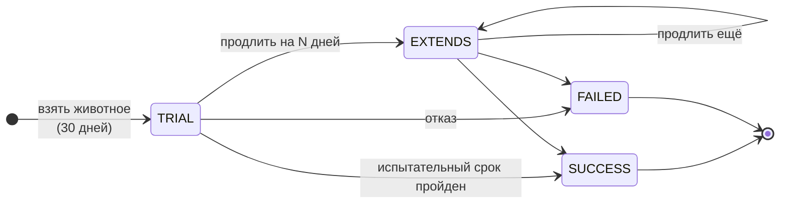
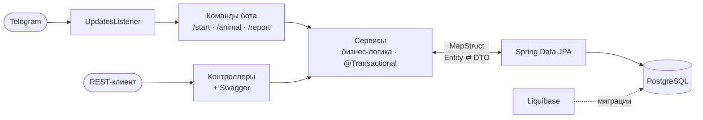

<div align="center">

# 🐾 NurseryAstanaBot

**Telegram-бот и REST API для приюта животных Астаны**

Подбор животных, пробный период усыновления и ежедневные отчёты новых хозяев

<br>


[Возможности](#-возможности) •
[Архитектура](#-архитектура) •
[Быстрый старт](#-быстрый-старт) •
[API](#-rest-api) •
[Тесты](#-тесты) •
[Команда](#-команда)

</div>

---

## 💡 О проекте

Человек находит бота, листает карточки животных, которые ищут дом, и одной кнопкой берёт питомца на **пробный период в 30 дней**. Каждый день он присылает боту отчёт — фото и пару строк о том, как дела. Сотрудники приюта через REST API видят все усыновления и отчёты и по итогам пробного периода **одобряют, продлевают или отменяют** усыновление.

>  Исходное техническое задание — в [docs/requirements.md](docs/requirements.md)

---

## ✨ Возможности

<table>
<tr>
<td width="50%" valign="top">

### Telegram-бот

| Команда | Действие |
|:--|:--|
| `/start` | регистрация и приветствие |
| `/animal` | карточки животных, «взять домой» |
| `/report` | ежедневный отчёт:  фото +  текст |
| `/help` | список команд |
| `/cancel` | отменить текущий сценарий |

</td>
<td width="50%" valign="top">

### REST API для приюта

- CRUD животных
- оформление усыновления
- управление пробным периодом
- пользователи и отчёты
- просмотр фото из отчётов
- вся документация в **Swagger UI**

</td>
</tr>
</table>

### Жизненный цикл усыновления



**Правила, которые сервис проверяет:**
- взять можно только животное со статусом `SEEKS_HOME`
- у одного животного не может быть двух активных пробных периодов
- завершённое усыновление нельзя продлить или изменить
- любая ошибка возвращается единым JSON через глобальный обработчик

---

## 🧩 Архитектура



Код организован **по доменам** — внутри каждого одинаковый набор слоёв:

```text
src/main/java/com/example/nurseryAstana
├── backend
│   ├── animal        controller · service/impl · repository · model · dto · mapper · exception
│   ├── adoption      ...
│   ├── user          ...
│   ├── report        ...
│   └── common        глобальный обработчик ошибок
└── telegram          слушатель обновлений · команды · конфигурация бота
```

> Схемой БД управляет только **Liquibase** — Hibernate работает в режиме `validate` и лишь сверяет сущности со схемой.

---

## 🚀 Быстрый старт

### Docker Compose

```bash
git clone https://github.com/neosomee/NurseryAstanaBot.git
cd NurseryAstanaBot
cp .env.example .env        # впишите токен бота и доступы к БД
docker compose up --build
```

Готово — PostgreSQL поднимется, миграции применятся, бот начнёт отвечать.

<details>
<summary><b>Запуск без Docker</b></summary>
<br>

Нужны **JDK 21**, **Maven** и PostgreSQL с базой `astana`.

```bash
export TELEGRAM_BOT_TOKEN=... DB_USERNAME=... DB_PASSWORD=...
mvn spring-boot:run

# с логированием SQL-запросов
mvn spring-boot:run -Dspring-boot.run.profiles=dev
```

</details>

### Переменные окружения

| Переменная | Описание | По умолчанию |
|:--|:--|:--|
| `TELEGRAM_BOT_TOKEN` | токен от [@BotFather](https://t.me/BotFather) | — |
| `DB_URL` | JDBC-адрес PostgreSQL | `jdbc:postgresql://localhost:5432/astana` |
| `DB_USERNAME` | пользователь БД | — |
| `DB_PASSWORD` | пароль БД | — |

### После запуска

| | |
|:--|:--|
| Swagger UI | http://localhost:8084/swagger-ui/index.html |
| OpenAPI | http://localhost:8084/v3/api-docs |

---

## 📡 REST API

<details>
<summary><b>Животные — <code>/animal</code></b></summary>

| Метод | Путь | Описание |
|:--|:--|:--|
| `GET` | `/animal` | список животных |
| `GET` | `/animal/{id}` | животное по id |
| `POST` | `/animal/create` | добавить животное |
| `PUT` | `/animal/update` | изменить животное |
| `DELETE` | `/animal/remove/{id}` | удалить (нельзя при активном усыновлении) |

</details>

<details>
<summary><b>Усыновления — <code>/adoptions</code></b></summary>

| Метод | Путь | Описание |
|:--|:--|:--|
| `GET` | `/adoptions` | все усыновления |
| `GET` | `/adoptions/{id}` | усыновление по id |
| `POST` | `/adoptions/create` | оформить пробный период |
| `PUT` | `/adoptions/trialdays/success/{id}` | испытательный срок пройден |
| `PUT` | `/adoptions/trialdays/extend/{id}` | продлить на N дней |
| `PUT` | `/adoptions/trialdays/fail/{id}` | отказ |
| `DELETE` | `/adoptions/remove/{id}` | удалить |

</details>

<details>
<summary><b>Пользователи и отчёты — <code>/api</code></b></summary>

| Метод | Путь | Описание |
|:--|:--|:--|
| `GET` | `/api/users` | все пользователи бота |
| `GET` | `/api/reports` | все отчёты |
| `GET` | `/api/reports/{id}/preview` | фото из отчёта |

</details>

---

## 🧪 Тесты

```bash
mvn test
```

| Уровень | Что проверяется | Инструменты |
|:--|:--|:--|
| Unit | бизнес-правила `AdoptionService` и `AnimalService` | JUnit 5 · Mockito |
| Web | контроллеры, коды ответов, JSON | MockMvc · TestRestTemplate |
| Бот | команды и обработка обновлений | Mockito |
| Интеграция | весь контекст + миграции на реальном PostgreSQL | Testcontainers |

> Интеграционный тест автоматически пропускается, если Docker не запущен.

---

## 👥 Команда

<table>
<tr>
<td width="50%" valign="top">

### Илья Титов
[](https://github.com/Enotik-G)

- домен **Adoption** целиком: связи с Animal и User, статусы, пробный период, транзакции
- домен **Animal**: сущность, статусы, CRUD, Swagger
- DTO-слой и маппинг на **MapStruct**
- команды `/start` и `/report`, слушатель обновлений
- кастомные исключения и глобальный обработчик ошибок
- env-конфигурация, Liquibase, unit-тесты, Docker

</td>
<td width="50%" valign="top">

### neosomee
[](https://github.com/neosomee)

- команды `/animal`, `/help`, `/cancel`
- сценарий взятия животного через бота
- сохранение и предпросмотр фото отчётов
- тесты контроллеров и команд бота
- первоначальная настройка проекта

</td>
</tr>
</table>

<div align="center">

<br>

Сделано с ❤️ для тех, у кого четыре лапы

</div>
